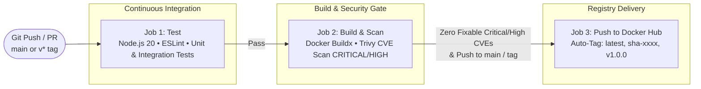

```markdown
# Project 02: End-to-End CI/CD & DevSecOps Pipeline (GitHub Actions + Trivy + Docker Hub)

[](https://github.com/auladwd)
[](https://hub.docker.com/u/auladdevops)
[](https://aquasecurity.github.io/trivy/)
[](https://nodejs.org/)

An automated **CI/CD & DevSecOps Pipeline** built with **GitHub Actions**, **Trivy**, and **Docker Hub**. Every push or pull request triggers automated code linting and testing, builds a multi-stage Docker image, scans it for `CRITICAL` and `HIGH` vulnerabilities using Trivy, and publishes versioned images (`latest`, commit SHA, and semantic `v*` tags) to Docker Hub only after passing all quality and security gates.

---

## Pipeline Architecture



---

## Key DevOps & DevSecOps Highlights

* **Automated Quality Gates:** Runs ESLint static analysis along with unit and integration tests on Node.js 20 prior to containerization.
* **Shift-Left Container Security (DevSecOps):** Integrates **Aqua Trivy** into the CI workflow to scan built Docker images and fail the pipeline if fixable `HIGH` or `CRITICAL` CVEs are detected.
* **Multi-Stage Alpine Containerization:** Builds lightweight, non-root production images using Docker Buildx with GitHub Actions layer caching (`type=gha`) for faster build times.
* **Automated Semantic & SHA Tagging:** Dynamically generates image tags (`latest`, `sha-<commit>`, and semantic version tags like `v1.0.0`) on pushes to `main` or release tags.
* **PR Validation Safe-Guard:** Executes testing and vulnerability scanning on Pull Requests without pushing unmerged artifacts to the container registry.

---

## Quick Start (Local Testing)

### 1. Clone & Navigate

```bash
git clone [https://github.com/auladwd/devops-cicd-pipeline.git](https://github.com/auladwd/devops-cicd-pipeline.git)
cd devops-cicd-pipeline/app

```

### 2. Run Linting & Automated Tests

```bash
npm install
npm run lint
npm test

```

### 3. Build, Run & Test Locally

```bash
docker build -t devops-cicd-demo:local .
docker run -d -p 3000:3000 --name cicd-test devops-cicd-demo:local

curl http://localhost:3000/health
curl "http://localhost:3000/api/sum?a=10&b=20"

docker rm -f cicd-test

```

### 4. Local Trivy Vulnerability Scan (Optional)

```bash
docker run --rm -v /var/run/docker.sock:/var/run/docker.sock \
  aquasec/trivy image --severity HIGH,CRITICAL devops-cicd-demo:local

```

---

## CI/CD Setup & Triggering Releases

### Required Repository Secrets

Configured under **Settings → Secrets and variables → Actions**:

* `DOCKERHUB_USERNAME` — Docker Hub account username (`auladdevops`)
* `DOCKERHUB_TOKEN` — Docker Hub Personal Access Token (`Read & Write` scope)

### Triggering a Semantic Release

```bash
git tag v1.0.0
git push origin v1.0.0

```

---

## CV / Resume Summary

* *Engineered an automated CI/CD pipeline using GitHub Actions to run automated linting, unit/integration tests, and multi-stage Docker builds.*
* *Integrated Trivy container vulnerability scanning into the CI pipeline to block images with fixable CRITICAL/HIGH CVEs before registry publishing.*
* *Automated semantic versioning (`v*`), commit-SHA tagging, and Buildx layer caching to publish production images to Docker Hub (`auladdevops`).*

```

```